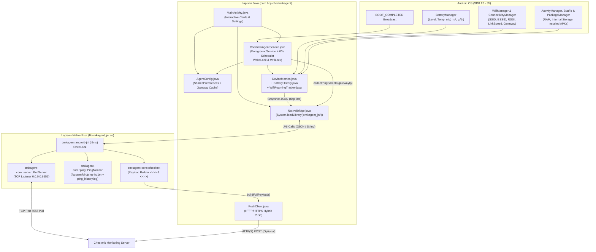

# BMS Agent Android (`BMS agen 1.3.8 stabil dan debug`)

Dokumen ini menjelaskan secara lengkap **arsitektur sistem**, **kombinasi bahasa pemrograman (Java + Rust JNI)**, **struktur modul**, **alur kerja internal**, serta **panduan instalasi dan penggunaan** aplikasi Android **BMS Agent** (`BMS-agen-1.3.8-stabil.apk` & `BMS-agen-1.3.8-debug.apk`).

> **Catatan Rilis v1.3.8 (Stabil & Debug):**
> - **Upgrade Mesin ke Hybrid Java 17 + Rust JNI (`libcmkagent_jni.so`):** TCP Pull Server (`6556`), filter IP/CIDR/RFC1918, formatter Checkmk, serta eksekutor ping paralel 4x/menit kini berjalan di mesin native **Rust** yang ringan, bebas *data race*, dan 100% seragam dengan protokol Checkmk.
> - **Grafik Real-Time Koneksi Loss (`ping_loss_1m`, `0%–100%`):** Selain grafik rata-rata 1 jam (`pl`) dan latensi (`rta`), setiap service `Ping_*` kini mengirimkan metrik `ping_loss_1m` per menit sehingga lonjakan 100% putus langsung terlihat jelas di grafik Checkmk, lengkap dengan rincian jam putus 24 jam terakhir (*terbaru dulu*).
> - **Perbaikan Deteksi Wi-Fi SSID, BSSID, & Vendor AP (Android 12–16):** Menggunakan `ConnectivityManager` (`TRANSPORT_WIFI` + `TransportInfo`) dan permintaan izin lokasi (`ACCESS_FINE_LOCATION` + `ACCESS_COARSE_LOCATION`) beserta tombol izin langsung pada kartu *Network*.
> - **Keystore Permanen & `versionCode` Otomatis:** Menggunakan `android/app/cmkagent.keystore` yang konsisten di setiap build CI (`SHA-256: 72:66:D8:CE:2F:24:82:2A:FD:1E:04:B0:6B:CA:7A:C4:97:06:53:25:4D:76:EE:27:1B:FC:E9:89:4E:36:5F:41`) sehingga pembaruan APK ke depannya dapat langsung menimpa versi lama tanpa bentrok tanda tangan (*package conflict*).
> - **Cache Gateway Cabang (`last_detected_gateway_ip`):** Saat Wi-Fi terputus sementara, target `Ping_Gateway` tetap dipertahankan sehingga status 100% loss tetap tercatat akurat di grafik maupun `ping_history.log`.

---

## 1. Identitas & Spesifikasi Aplikasi Android

| Parameter | Nilai / Spesifikasi |
| :--- | :--- |
| **Nama Aplikasi / Rilis** | `BMS Agent` (`BMS agen 1.3.8 stabil dan debug`) |
| **Application ID (Package)** | Stabil: `com.bcp.checkmkagent` \| Debug: `com.bcp.checkmkagent.debug` |
| **Versi Agen (Checkmk)** | `Agen BMS : 1.3.8` (`versionName = "1.3.8"`, `versionCode` naik otomatis tiap build CI) |
| **Minimum / Target Android SDK** | `minSdk 26` (Android 8.0 Oreo) s/d `compileSdk 35` (Android 15/16) |
| **Arsitektur CPU (ABI)** | `arm64-v8a` (64-bit ARM), `armeabi-v7a` (32-bit ARM), `x86_64` (Emulator/x86 Tablet) |
| **Signing Keystore** | Permanen PKCS12 (`android/app/cmkagent.keystore`, alias `cmkagent`) |
| **Port Monitoring Default** | TCP `6556` (Pull Primary — Open RFC1918/VPN/NAT) + HTTP/HTTPS POST (Push Backup Hybrid) |
| **Perangkat Sasaran** | Handheld PDA Scanner Gudang (Newland MT93: `2946 mAh @ 100%` / `Design 4800 mAh`), Smartphone, & Tablet Cabang |

---

## 2. Bahasa Pemrograman yang Digunakan (Arsitektur Hybrid 2 Bahasa)

Aplikasi Android **BMS Agent** dibangun menggunakan arsitektur **Dual-Language Hybrid** yang memadukan **Java** di lapisan sistem Android dan **Rust** di lapisan *core engine* melalui **JNI (*Java Native Interface*)**:

### A. Java (Java 17 — Android Framework & UI Layer)
Terletak pada direktori `android/app/src/main/java/com/bcp/checkmkagent/`.
**Alasan teknis penggunaan Java:**
1. **Akses Native ke Layanan OS Android (ART):** Seluruh sensor perangkat Android (kesehatan & arus baterai `BatteryManager`, sinyal & BSSID Wi-Fi `WifiManager`, routing gateway `ConnectivityManager`, memori `ActivityManager`, penyimpanan `StatFs`, dan daftar APK `PackageManager`) diakses secara resmi dan stabil melalui Android SDK.
2. **Manajemen Siklus Hidup Latar Belakang (*Foreground Service*):** Android menerapkan pembatasan daya ketat (*Doze Mode* & *Background Execution Limits*). Lapisan Java mengelola `CheckmkAgentService` dengan tipe `FOREGROUND_SERVICE_TYPE_DATA_SYNC`, `PARTIAL_WAKE_LOCK`, `WIFI_MODE_FULL_HIGH_PERF`, serta `BootReceiver` (`BOOT_COMPLETED`) agar agen tetap hidup 24/7 tanpa dimatikan OS.
3. **Antarmuka Pengguna (*Zero-Bloat Programmatic UI*):** `MainActivity.java` membangun seluruh tampilan kartu interaktif (*Expand/Collapse*, *Start/Stop Service*, *View Ping Log*, *Settings*) secara langsung menggunakan komponen native Android tanpa pustaka UI pihak ketiga, sehingga ukuran APK tetap kecil (~2 MB) dan sangat ringan di PDA gudang.

### B. Rust (Rust 2021 Edition — Native Core & Network Engine via JNI)
Terletak pada workspace `android/rust/` (`crates/cmkagent-android-jni/` dan `crates/cmkagent-core/`) yang dikompilasi menggunakan **Android NDK (`cargo-ndk`)** menjadi pustaka biner native `libcmkagent_jni.so`.
**Alasan teknis penggunaan Rust:**
1. **Keseragaman Protokol 100% dengan Agen Checkmk:** Mesin pembuat output Checkmk (`<<<check_mk>>>`, `<<<local:sep(0)>>>`, `<<<local:cached(...):sep(0)>>>`), filter keamanan IP/CIDR/RFC1918, dan kalkulator statistik ping berjalan di crate `cmkagent-core`.
2. **Server TCP Pull Multi-Thread & Non-Blocking (`PullServer`):** Menangani socket TCP `0.0.0.0:6556` secara langsung di kode native Rust dengan manajemen *socket timeout*, `TCP_NODELAY`, serta pembersihan thread otomatis tanpa membebani *Garbage Collector* (GC) Java.
3. **Eksekusi Ping Paralel 4x/Menit & Log Bergulir 30 Hari (`PingMonitor`):** Menggunakan `std::thread::scope` di Rust untuk menjalankan ICMP ping (`/system/bin/ping -c 4 -W 2`) ke 3 target (`8.8.8.8`, `192.168.122.10`, dan `Gateway Cabang`) secara paralel setiap 60 detik, menghitung metrik real-time `ping_loss_1m` (`0%–100%`) serta rata-rata 1 jam (`pl`, `rta`, `rtmin`, `rtmax`), dan merawat file `ping_history.log` (retensi 30 hari, batas ukuran 35 MB).
4. **Keamanan Memori & Konkurensi Tanpa *Data Race*:** State global disimpan dalam `OnceLock<RuntimeState>` yang dilindungi oleh `RwLock<AgentConfig>`, `Mutex<Arc<PingMonitor>>`, dan `AtomicU64` (`AgentStats`).

### C. Ringkasan Pembagian Peran Java vs Rust

| Lapisan / Fitur | Bahasa | Lokasi Kode | Tugas Utama |
| :--- | :--- | :--- | :--- |
| **UI Dashboard & Settings** | Java | `MainActivity.java`, `AgentConfig.java` | Kartu status interaktif, form konfigurasi, `SharedPreferences`, tombol izin lokasi |
| **Background Daemon & Locks** | Java | `CheckmkAgentService.java`, `BootReceiver.java` | Foreground Service 60s scheduler, WakeLock, WifiLock, Auto-Boot |
| **Hardware & OS Telemetry** | Java | `DeviceMetrics.java`, `BatteryHistory.java`, `WifiRoamingTracker.java` | Pembacaan baterai (µAh/mA/suhu/siklus), RAM, Storage, BSSID Roaming, & Inventory APK |
| **HTTP(S) Push Backup** | Java | `PushClient.java` | Pengiriman snapshot cadangan via `HttpURLConnection` ke Push Receiver |
| **Jembatan JNI** | Java + Rust | `NativeBridge.java` <-> `android/rust/crates/cmkagent-android-jni/src/lib.rs` | Konversi tipe `JString`/`jboolean`/`jint` dan serialisasi JSON `serde_json` |
| **TCP Pull Server (6556)** | Rust | `android/rust/crates/cmkagent-core/src/server.rs` | Listener TCP `0.0.0.0:6556`, validasi IP/CIDR/RFC1918, pengiriman payload |
| **Ping Engine & 30d Log** | Rust | `android/rust/crates/cmkagent-core/src/ping.rs` | Ping paralel 3 target, grafik `ping_loss_1m` (0–100%), ringkasan putus 24 jam |
| **Checkmk Formatter & Stats** | Rust | `android/rust/crates/cmkagent-core/src/checkmk.rs`, `stats.rs` | Penyusunan format section Checkmk & pencatatan statistik koneksi |

---

## 3. Diagram Arsitektur & Alur Data Aplikasi Android



---

## 4. Rincian Modul Kode Sumber Android

### A. Modul Java (`android/app/src/main/java/com/bcp/checkmkagent/`)
1. **`MainActivity.java`**
   - Dashboard berlatar gelap (`#0D1518`) dengan 8 kartu *collapsible*: `AGENT`, `HYBRID TRANSPORT`, `BATTERY (1-LINE UNIFIED)`, `SYSTEM`, `NETWORK, AP ROAMING & PING (1H)`, `APPLICATIONS`, `DEVICE`, dan `SETTINGS`.
   - Memperbarui tampilan otomatis setiap 3 detik saat layar aktif.
   - Menyediakan aksi instan: `▶ START AGENT`, `■ STOP AGENT`, `EXPAND ALL`, `COLLAPSE ALL`, `VIEW PING LOG` (150 baris terakhir `ping_history.log`), `PING 4X NOW`, `PUSH SNAPSHOT NOW`, serta tombol aktivasi izin lokasi/GPS jika SSID Wi-Fi belum terbaca.
2. **`CheckmkAgentService.java`**
   - Berjalan sebagai Android `ForegroundService` (`NOTIF_ID = 6556`) dengan `PARTIAL_WAKE_LOCK` dan `WIFI_MODE_FULL_HIGH_PERF` agar radio Wi-Fi dan jadwal ping tetap aktif meski layar PDA terkunci.
   - Menjalankan `ScheduledExecutorService` setiap **60 detik** untuk sinkronisasi konfigurasi ke Rust, pengumpulan telemetri perangkat, eksekusi ping 4x ke 3 target, dan HTTP(S) Push Backup (jika aktif).
3. **`DeviceMetrics.java`**
   - Mengumpulkan data perangkat Android dan menyusunnya menjadi JSON (`AndroidSnapshotPayload`) berisi `local_checks` (`Health_Battery`, `Android_Info`, `WiFi_Status`, `RAM_Usage`, `Storage_Usage`) serta `raw_sections` (`<<<lnx_uname>>>`, `<<<lnx_distro:sep(124)>>>`, `<<<lnx_cpuinfo:sep(58)>>>`, `<<<dmidecode:sep(58)>>>`, `<<<lnx_block_devices:sep(0)>>>`, `<<<lnx_packages:sep(124)>>>`).
   - Menerapkan **cache inventaris 6 jam** (`21.600.000 ms`) untuk pembacaan daftar paket APK (`PackageManager.getInstalledPackages`) agar hemat CPU & baterai.
4. **`BatteryHistory.java`**
   - Mengombinasikan pembacaan Coulomb counter (`BATTERY_PROPERTY_CHARGE_COUNTER` dalam `µAh`), profil perangkat (termasuk Newland `MT93` = `2946 mAh @ 100%` / `4800 mAh Design Spec`), serta akumulasi delta muatan untuk menghitung **Real Health (%)** dan **Estimated Cycles** secara presisi.
5. **`WifiRoamingTracker.java`**
   - Memantau perpindahan BSSID Access Point dan kanal frekuensi (`2.4GHz`, `5GHz`, `6GHz`) setiap menit.
   - Mengidentifikasi vendor Access Point dari prefix MAC/OUI (`UniFi AP`, `MikroTik AP`, `Aruba AP`, `Cisco AP`, `TP-Link`, `Ruijie`, dll.) dan menghitung frekuensi roaming 1 jam terakhir (`wifi_roam_1h`) beserta riwayat transisi terakhir.
6. **`AgentConfig.java`**
   - Menyimpan konfigurasi di `SharedPreferences` (`cmkagent_rust_prefs`), mendeteksi IPv4 perangkat serta IP Gateway Wi-Fi dari `ConnectivityManager` / `DhcpInfo`, dan menyimpan cache `last_detected_gateway_ip`.
7. **`NativeBridge.java`**
   - Kelas pembungkus `static` yang memuat `System.loadLibrary("cmkagent_jni")` dan mendeklarasikan 11 method `native` penghubung Java ke Rust.
8. **`PushClient.java` & `BootReceiver.java`**
   - `PushClient.java`: mengirim output agen lengkap melalui HTTP(S) `POST` (header `X-CMK-Hostname`, `Authorization: Bearer <token>`) dan mencatat hasilnya ke Rust.
   - `BootReceiver.java`: menangkap sinyal `BOOT_COMPLETED` dan `QUICKBOOT_POWERON` untuk menyalakan `CheckmkAgentService` secara otomatis saat perangkat dinyalakan.

### B. Modul Rust (`android/rust/crates/cmkagent-android-jni/` & `android/rust/crates/cmkagent-core/`)
1. **`cmkagent-android-jni/src/lib.rs`**
   - Mengimplementasikan simbol-simbol JNI `Java_com_bcp_checkmkagent_NativeBridge_*` dan singleton `RUNTIME: OnceLock<RuntimeState>`.
2. **`cmkagent-core/` (`config.rs`, `server.rs`, `ping.rs`, `checkmk.rs`, `stats.rs`, `cache.rs`)**
   - Listener TCP `6556`, filter IP/CIDR/RFC1918, eksekutor ping paralel 4x/menit, metrik grafik `ping_loss_1m` (`0%–100%`) + `pl` (1 jam) + `rta`, serta generator payload Checkmk.

---

## 5. Kontrak Antarmuka JNI (`NativeBridge`)

| Method Java (`NativeBridge.java`) | Fungsi Rust (`cmkagent-android-jni/src/lib.rs`) | Keterangan |
| :--- | :--- | :--- |
| `startPullServer(configJson, dataDir)` | `Java_..._startPullServer` | Menginisialisasi `PingMonitor` di `filesDir` aplikasi dan membuka listener TCP `0.0.0.0:6556` |
| `stopPullServer()` | `Java_..._stopPullServer` | Menghentikan thread `PullServer` dan melepas port `6556` |
| `updateConfig(configJson)` | `Java_..._updateConfig` | Memperbarui `AgentConfig` di memori Rust secara live tanpa memutus koneksi |
| `updateSnapshot(snapshotJson)` | `Java_..._updateSnapshot` | Menyimpan snapshot telemetri baterai, Wi-Fi, RAM, storage, & inventaris APK dari Java |
| `collectPingSample(gatewayIp)` | `Java_..._collectPingSample` | Menjalankan 4x ping paralel ke `8.8.8.8`, `192.168.122.10`, & gateway lalu menulis ke `ping_history.log` |
| `buildFullPayload()` | `Java_..._buildFullPayload` | Merakit output teks Checkmk lengkap untuk keperluan Pull maupun Push |
| `readPingLogTail(maxLines)` | `Java_..._readPingLogTail` | Membaca `N` baris terakhir dari log ping 30 hari untuk ditampilkan di dialog UI |
| `getStatsJson()` | `Java_..._getStatsJson` | Mengembalikan JSON statistik jumlah pull diterima/ditolak, IP client terakhir, & status push |
| `recordPushResult(ok, code, detail)` | `Java_..._recordPushResult` | Mencatat keberhasilan/kegagalan HTTP(S) Push dari `PushClient.java` ke `AgentStats` |
| `normalizeRemoteIp(ip)` | `Java_..._normalizeRemoteIp` | Menormalisasi alamat IPv6-mapped IPv4 (`::ffff:192.168.x.x` -> `192.168.x.x`) |
| `isClientAllowed(configJson, ip)` | `Java_..._isClientAllowed` | Mengecek apakah IP pengakses diizinkan oleh aturan whitelist / RFC1918 |

---

## 6. Daftar 14 Service Checkmk yang Dihasilkan APK Android

1. **`Check_MK`** — Status eksekusi pull & waktu respons agen.
2. **`Check_MK Agent`** — Informasi versi `Agen BMS : 1.3.8` & OS `android`.
3. **`Check_MK Discovery`** — Pemeriksaan service baru (0 *unmonitored clutter*).
4. **`Check_MK HW/SW Inventory`** — Inventaris CPU ARM/x86, RAM, kapasitas flash internal (`mmcblk0`), versi Android, & seluruh paket APK terinstal (cache 6 jam).
5. **`Agent_Status`** — Statistik pull diterima/ditolak, IP server Checkmk penarik terakhir, dan mode akses jaringan.
6. **`Android_Info`** — Pabrikan, model perangkat, versi Android, level SDK, dan *uptime*.
7. **`Health_Battery`** — Ringkasan 1-baris lengkap: persentase baterai, status charging/discharging, *Real Health (%)*, jumlah siklus (*cycles*), kapasitas penuh aktual vs desain (`mAh`), suhu (`°C`), voltase (`V`), dan arus (`mA`).
8. **`Ping_8.8.8.8`** — Monitoring ping Internet 4x/menit: grafik **`Ping loss 1m`** (`ping_loss_1m` `0%–100%` real-time per menit), grafik **`Packet loss`** (`pl` rata-rata 1 jam), grafik **`Round trip average`** (`rta`, `rtmin`, `rtmax`), serta daftar jam putus 24 jam terakhir (*terbaru dulu*).
9. **`Ping_192.168.122.10`** — Monitoring ping Server Lokal 4x/menit (grafik `ping_loss_1m`, `pl` 1 jam, `rta`, & daftar jam putus 24 jam).
10. **`Ping_Gateway`** — Monitoring ping IP Gateway Wi-Fi Cabang 4x/menit (tetap merekam `100%` loss saat Wi-Fi drop berkat cache `last_detected_gateway_ip`).
11. **`RAM_Usage`** — Persentase & kapasitas RAM terpakai/bebas/total (cache 30 menit, `WARN` 85%, `CRIT` 95%).
12. **`Storage_Usage`** — Persentase & kapasitas penyimpanan internal terpakai/bebas/total (cache 24 jam, `WARN` 85%, `CRIT` 95%).
13. **`Transport_Status`** — Status jalur komunikasi Hybrid (`PULL` primary + `PUSH HTTP(S)` backup).
14. **`WiFi_Status`** — Status koneksi Wi-Fi, SSID, BSSID & vendor AP (`UniFi`/`MikroTik`/`Aruba`/`Cisco`), pita frekuensi & kanal (`2.4GHz`/`5GHz`/`6GHz`), frekuensi roaming 1 jam terakhir (`wifi_roam_1h`), kekuatan sinyal (`dBm`), kecepatan link (`Mbps`), dan IP lokal.

---

## 7. Cara Instalasi APK Android (`BMS agen 1.3.8 stabil dan debug`)

### A. Mengunduh APK
Unduh berkas APK dari halaman **GitHub Releases** (`BMS agen 1.3.8 stabil dan debug`) atau dari **GitHub Actions Artifacts** (`BMS-agen-1.3.8-stabil-dan-debug`):
- **`BMS-agen-1.3.8-stabil.apk`** (`com.bcp.checkmkagent`) — **Gunakan file ini untuk operasional/produksi** pada PDA gudang (Newland MT93) dan perangkat cabang.
- **`BMS-agen-1.3.8-debug.apk`** (`com.bcp.checkmkagent.debug`) — Khusus pengujian/QC; dapat diinstal berdampingan dengan versi Stabil di perangkat yang sama.

### B. Langkah Instalasi di Perangkat Android / PDA
> **Penting bagi perangkat yang sebelumnya menggunakan v1.3.7 atau versi lama dengan keystore berbeda:**
> Lakukan **Uninstall** aplikasi `cmkagent` / `BMS Agent` lama **satu kali saja** sebelum memasang `BMS-agen-1.3.8-stabil.apk`. Mulai versi `1.3.8` ini dan seterusnya, keystore sudah permanen sehingga pembaruan berikutnya cukup langsung timpa (*install update*) tanpa perlu uninstall.

1. **Instalasi Langsung di Perangkat:**
   - Salin `BMS-agen-1.3.8-stabil.apk` ke penyimpanan internal PDA/HP.
   - Buka berkas APK melalui File Manager -> izinkan **Install from Unknown Sources** (*Instal aplikasi tidak dikenal*) bila diminta -> ketuk **Install**.
2. **Instalasi Massal via ADB (Opsional untuk Tim IT):**
   ```bash
   adb install -r BMS-agen-1.3.8-stabil.apk
   ```
3. **Berikan Izin Wajib Setelah Aplikasi Dibuka Pertama Kali:**
   - **Izin Notifikasi (Android 13+):** Pilih **Izinkan / Allow** agar ikon notifikasi *Foreground Service* (`Agen BMS ACTIVE`) tampil dan layanan tidak dihentikan OS.
   - **Izin Lokasi Presisi (`Allow all the time` / `Precise Location`) & Aktifkan GPS:** **Wajib** agar Android 12–16 mengizinkan aplikasi membaca **Nama SSID, BSSID, dan Vendor Access Point Wi-Fi**. Jika di kartu Network tampil `SSID: <Izin Lokasi Diperlukan>`, ketuk tombol izin lokasi yang tersedia langsung di kartu tersebut.
   - **Pengecualian Optimasi Baterai (*Unrestricted / Don't Optimize*):** Pilih **Allow / Izinkan** saat diminta agar sistem *Doze Mode* tidak memutus koneksi TCP `6556` dan scheduler ping 1 menit saat layar PDA mati.

---

## 8. Cara Penggunaan & Konfigurasi

### A. Pengaturan pada Aplikasi Android (Kartu `SETTINGS`)
Buka aplikasi **BMS Agent**, lalu ketuk kartu **SETTINGS** untuk membuka formulir konfigurasi:
1. **Hostname Checkmk:**
   - Isi nama host sesuai penamaan di server Checkmk cabang (contoh: `PDAGUDANG-KDR01` atau `MT93-SBY02`).
2. **Mode Akses Jaringan (`Izinkan semua IP Private/NAT/VPN`):**
   - **Disarankan ON (Default):** Mengizinkan seluruh jaringan internal/private RFC1918 (`192.168.x.x`, `10.x.x.x`, `172.16.x.x–172.31.x.x`), CGNAT/VPN (`100.64.x.x`), dan lalu lintas yang terkena NAT/Masquerade MikroTik cabang (sama seperti agen Windows & Linux).
   - **IP Server Checkmk Cabang (Opsional):** Boleh dikosongkan. Jika ingin membatasi akses hanya ke 1 IP server tertentu, matikan toggle RFC1918 lalu isi IP server Checkmk cabang.
3. **IP Gateway Cabang (Ping Monitor Baris ke-3):**
   - Ketuk tombol **`AUTO-DETECT GATEWAY DARI WI-FI`** untuk mendeteksi IP gateway router/MikroTik cabang secara otomatis (misal `192.168.55.1`), atau ketik manual.
4. **Design Capacity (mAh, `0 = auto`):**
   - Biarkan `0` untuk deteksi otomatis (termasuk kalibrasi otomatis Newland MT93). Isi manual jika menggunakan perangkat khusus yang tidak melaporkan kapasitas desain baterai.
5. **Simpan & Jalankan:**
   - Ketuk **SAVE SETTINGS**, lalu pastikan status agen **RUNNING** (jika belum, ketuk tombol **`▶ START AGENT`**).

### B. Menu Aksi Harian di Dashboard Aplikasi
- **`▶ START AGENT` / `■ STOP AGENT`:** Menyalakan atau menghentikan *Foreground Service* dan port TCP `6556`.
- **`VIEW PING LOG`:** Membuka 150 baris terakhir riwayat ping 30 hari (`ping_history.log`) langsung di layar PDA untuk pengecekan cepat saat ada keluhan jaringan gudang.
- **`PING 4X NOW`:** Memicu 1 siklus ping instan ke `192.168.122.10`, `8.8.8.8`, dan `Gateway Cabang` tanpa menunggu 60 detik.
- **`PUSH SNAPSHOT NOW`:** Mengirim snapshot manual ke HTTP(S) Push Receiver (khusus jika mode Hybrid Push diaktifkan).

### C. Menambahkan Perangkat di Server Checkmk
1. Buka **Setup -> Hosts -> Add host** pada web Checkmk cabang.
2. Masukkan **Host name** (samakan dengan Hostname di aplikasi) dan **IPv4 address** PDA (disarankan dibuat *Static DHCP Lease* di MikroTik cabang agar IP PDA tidak berubah-ubah).
3. Pada bagian **Monitoring agents**, pilih **API integrations if configured, else Checkmk agent** (port default TCP `6556`).
4. Klik **Save & run service discovery**, terima 14 service yang terdeteksi, lalu klik **Activate changes**.

### D. Verifikasi Koneksi dari Server Checkmk (CLI)
```bash
# Uji tarik data langsung dari server Checkmk ke IP PDA Android
nc -w 5 <IP_PDA_ANDROID> 6556 | head -n 40
```
Pastikan baris awal menampilkan:
```text
<<<check_mk>>>
Version: Agen BMS : 1.3.8
AgentOS: android
Hostname: <HOSTNAME_PDA>
```

---

## 9. Cara Build APK Android dari Source Code (Untuk Developer)

```bash
# 1. Jalankan unit test mesin inti Rust
cargo test --manifest-path android/rust/Cargo.toml -p cmkagent-core

# 2. Kompilasi library native Rust JNI untuk ketiga arsitektur Android
cargo ndk -t arm64-v8a -t armeabi-v7a -t x86_64 \
  -o android/app/src/main/jniLibs \
  build --manifest-path android/rust/Cargo.toml -p cmkagent-android-jni --release

# 3. Build APK Stabil (Release) & Debug menggunakan Gradle
cd android
gradle --no-daemon :app:assembleRelease :app:assembleDebug
```

Hasil build tersedia di:
- **APK Stabil:** `android/app/build/outputs/apk/release/app-release.apk` (dirilis sebagai `BMS-agen-1.3.8-stabil.apk`)
- **APK Debug:** `android/app/build/outputs/apk/debug/app-debug.apk` (dirilis sebagai `BMS-agen-1.3.8-debug.apk`)

---

**Dibuat & Dikelola oleh IT OPS HQEJBNT**
