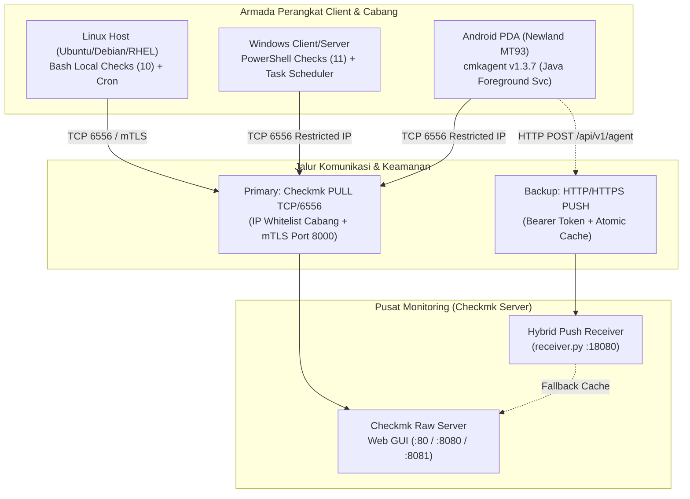

# Checkmk Enterprise-Grade Monitoring Suite - Standar IT OPS Nasional (`checkmk-cabang`)


Ekosistem pemantauan infrastruktur (*monitoring agent suite*) standar operasional terpusat **IT OPS NASIONAL** untuk **Checkmk** yang menyatukan pengawasan perangkat **Linux Host (Desktop Kasir / Server Cabang)**, **Windows Client/Server (PC Kasir, Backoffice, Laptop Operasional)**, dan **Android Industrial PDA (Newland NLS-MT93 & Generic Android)** ke dalam satu standar metrik, format output, dan ambang batas (*threshold*) yang seragam di seluruh kantor cabang dan regional.

Seluruh kode sumber, skrip _local checks_, aplikasi native Android (`cmkagent`), _auto-updater_, serta pipeline CI/CD dikelola secara terpusat di repositori resmi:  
🌐 **`itlicensehq25/checkmk-cabang`** (https://github.com/itlicensehq25/checkmk-cabang)  
*(Kredit & apresiasi untuk Mas Aziz dan Mas Dodik atas fondasi dan pengembangan sistem)*

---

## Daftar Isi

1. [Bahasa Pemrograman & Stack Teknologi](#-1-bahasa-pemrograman--stack-teknologi)
2. [Arsitektur Sistem & Standar Production-Ready (15 Layer Stack)](#-2-arsitektur-sistem--standar-production-ready-15-layer-stack)
3. [Struktur Direktori Repositori](#-3-struktur-direktori-repositori)
4. [Tutorial Penggunaan Lengkap (Step-by-Step)](#-4-tutorial-penggunaan-lengkap-step-by-step)
   - [Tahap 1: Menjalankan Server Checkmk (Docker Compose)](#tahap-1-menjalankan-server-checkmk-docker-compose)
   - [Tahap 2: Deployment Agen pada Linux Host](#tahap-2-deployment-agen-pada-linux-host)
   - [Tahap 3: Deployment Agen pada Windows Host](#tahap-3-deployment-agen-pada-windows-host)
   - [Tahap 4: Pemasangan & Konfigurasi pada Android PDA (`cmkagent v1.3.7`)](#tahap-4-pemasangan--konfigurasi-pada-android-pda-cmkagent-v137)
   - [Tahap 5: Pendaftaran Host & Service Discovery di Checkmk Server](#tahap-5-pendaftaran-host--service-discovery-di-checkmk-server)
   - [Tahap 6: Penggunaan Hybrid Push Receiver (`server-test`)](#tahap-6-penggunaan-hybrid-push-receiver-server-test)
5. [Matriks Standardisasi Threshold & Alerting](#-5-matriks-standardisasi-threshold--alerting)
6. [Katalog Detail Local Checks (Linux, Windows, & Android PDA)](#-6-katalog-detail-local-checks-linux-windows--android-pda)
7. [Panduan Troubleshooting & Operasional Produksi](#-7-panduan-troubleshooting--operasional-produksi)

---

## 💻 1. Bahasa Pemrograman & Stack Teknologi

Repositori ini dibangun menggunakan kombinasi bahasa pemrograman dan pustaka tingkat sistem (*system-level libraries*) yang disesuaikan dengan karakteristik masing-masing sistem operasi:

| Komponen / Platform | Bahasa Pemrograman | Versi / Runtime | Pustaka, API, & Utilitas Sistem yang Digunakan |
| :--- | :--- | :--- | :--- |
| **Android PDA Agent (`cmkagent`)** | **Java** | Java 17 (Compile SDK 35, Target SDK 33, Min SDK 26) | Android SDK (`BatteryManager`, `WifiManager`, `ConnectivityManager`, `ActivityManager`, `StatFs`, `PackageManager`, `ForegroundService`), Linux Kernel `sysfs`, `/system/bin/ping`, Gradle 8.9 |
| **Windows Agent & Checks** | **PowerShell**, **VBScript**, **Batch (.bat)** | PowerShell 5.1+ / .NET Framework 4.5+ | WMI / CIM (`Win32_OperatingSystem`, `Win32_Volume`, `Win32_PhysicalMemory`, `MSAcpi_ThermalZoneTemperature`), `LibreHardwareMonitorLib.dll`, `CrystalDiskInfo` (`/CopyExit`), `ospp.vbs`, Windows Task Scheduler, `NetFirewallRule` |
| **Linux Agent & Checks** | **Bash (Shell Script)** | GNU Bash 4.x / 5.x (POSIX-compliant) | `smartmontools` (`smartctl`), `HDSentinel` CLI, `lm-sensors`, `upower`, `dmidecode`, `memtester`, `iproute2`, `/proc/net/dev`, `/proc/meminfo`, `systemd` / `cron` |
| **Hybrid Push Receiver** | **Python** | Python 3.8+ | Standard Library (`http.server.ThreadingHTTPServer`, `json`, `tempfile`, `os.fsync`, atomic `os.replace`) |
| **Infrastruktur & CI/CD** | **YAML (Docker & GitHub Actions)** | Docker Compose v3.8, GitHub Actions Runner (`ubuntu-latest`) | `checkmk/check-mk-raw:2.3.0-latest`, `actions/setup-java@v4` (Temurin 17), `android-actions/setup-android@v3` |

---

## 🏗️ 2. Arsitektur Sistem & Standar Production-Ready (15 Layer Stack)

Sistem ini dirancang mengikuti **5 Pilar & 15 Lapisan Rekayasa Production-Ready**:



### Penerapan 15 Lapisan Production-Ready pada `checkmk-cabang`:

1. **System Design (Synchronous vs Asynchronous Separation):**
   - Metrik ringan (CPU, RAM, Baterai, Wi-Fi) dibaca secara *real-time* saat polling, sedangkan pekerjaan berat yang memakan waktu (seperti uji stres RAM `memtester` 128 MB, pembacaan SMART `CrystalDiskInfo`, dan agregasi 240 paket Ping selama 1 jam) dijalankan secara **asinkron di latar belakang** (via Cron, Task Scheduler, atau `ScheduledExecutorService`), lalu hasilnya dibaca secara instan dari file log/cache.
2. **System Architecture (Modular & Cross-Platform Contract):**
   - Setiap metrik dipisahkan ke dalam skrip/kelas independen yang menghasilkan kontrak output pipa standar Checkmk (`<state> "<Service_Name>" <perfdata> <Summary Text | Field 2 | Field 3>`).
3. **Frontend / Mobile UI (`MainActivity.java`):**
   - Antarmuka *dark mode* ergonomis untuk layar industri Newland MT93 dengan kartu *collapsible*, indikator warna status (*badge* OK/WARN/CRIT), validasi input interaktif, serta penampil log langsung di layar (`VIEW PING LOG` & `VIEW ROAMING LOG`).
4. **APIs & Transport Protocol:**
   - Arsitektur **Hybrid Transport** pada Android PDA: jalur utama *PULL* TCP/6556 (`ServerSocket` *non-busy blocking*) ditambah jalur cadangan *PUSH* HTTP/HTTPS (`PushClient.java`) dengan *connect/read timeout* eksplisit (5–10 detik).
5. **Storage & Log Retention (30-Day CCTV Loop Recording):**
   - Di seluruh platform (**Linux**, **Windows**, dan **Android PDA**), log ping per menit (`ping_history.log`) dikelola dengan **retensi bergulir 30 hari** (`LOG_RETENTION_DAYS = 30`). Saat memasuki **hari ke-31 dan seterusnya**, baris log yang berumur lebih dari 30 hari otomatis dihapus (*atomic temp-file swap*), menjaga pemakaian ruang simpan tetap stabil (~8 MB) seperti DVR CCTV:
     - **Linux**: `/var/log/checkmk_custom/ping_history.log` (Konfigurasi Gateway: `/etc/check_mk/gateway_ip.conf`)
     - **Windows**: `C:\ProgramData\checkmk\agent\log_custom\ping_history.log` (Konfigurasi Gateway: `C:\ProgramData\checkmk\agent\config\gateway_ip.txt`)
     - **Android PDA**: `ping_history.log` pada internal/external files aplikasi `cmkagent`
   - Di `receiver.py`, penyimpanan payload memakai `tempfile.mkstemp` + `os.fsync` + `os.replace` (*atomic file replacement*) agar file tidak pernah korup saat dibaca bersamaan.
6. **Auth & Permissions:**
   - Pendaftaran agen Linux/Windows terenkripsi mTLS melalui `cmk-agent-ctl` (port `8000`).
   - Endpoint HTTP Push Receiver dilindungi autentikasi header `Authorization: Bearer <token>`.
   - Penanganan izin *runtime* Android 11–16 (`ACCESS_FINE_LOCATION`, `NEARBY_WIFI_DEVICES`, `POST_NOTIFICATIONS`, `REQUEST_IGNORE_BATTERY_OPTIMIZATIONS`) dengan *graceful fallback*.
7. **Hosting & Containerization:**
   - Tersedia spesifikasi `docker-compose-checkmk.yml` siap pakai dengan volume persisten (`checkmk-data`), sinkronisasi zona waktu `/etc/localtime:ro`, dan kebijakan `restart: unless-stopped`.
8. **CI/CD & Automated Update:**
   - GitHub Actions (`.github/workflows/build-cmkagent.yml`) mengompilasi, menandatangani (*signing*), dan memublikasikan artefak APK secara otomatis setiap ada perubahan pada `android/**`.
   - Skrip `windows/update_checks.ps1` membandingkan *hash* **SHA-256** antara skrip lokal dan GitHub sebelum memperbarui file secara otomatis tanpa *downtime*.
9. **Security & Network Hardening:**
   - **Pembatasan Firewall Port 6556 berbasis IP Server Cabang:** Baik di `windows/install.ps1` (`New-NetFirewallRule -RemoteAddress`) maupun di `cmkagent` Android (`AgentConfig.isClientAllowed()`), port `6556` **tidak dibiarkan terbuka ke seluruh jaringan**, melainkan dikunci hanya untuk IP Server Checkmk cabang yang dikonfigurasi (mendukung format `IP` murni maupun `IP:Port` seperti `:80`, `:8080`, `:8081`).
   - Sanitasi ketat terhadap nama host (`[^A-Za-z0-9._-]`) untuk mencegah *path traversal* dan *command injection*.
10. **Rate Limiting & Polling Throttling:**
    - Pembatasan ukuran payload maksimal 2 MB pada `receiver.py` dan interval minimum pengiriman Push 60 detik.
11. **Multi-Tier Caching & TTL (`<<<local:cached(ts,ttl)>>>`):**
    - Menghemat baterai PDA dan beban CPU client dengan TTL bertingkat:
      - *Real-time (60 dtk)*: `Agent_Status`, `Health_Battery` (1 baris terpadu), `WiFi_Status` (termasuk deteksi Roaming AP), `Android_Info`
      - *Cache 30 Menit (`1800s`)*: `RAM_Usage`
      - *Cache 1 Jam (`3600s`)*: `Ping_192.168.122.10`, `Ping_8.8.8.8`, & `Ping_Gateway` (agregasi 60 menit / 240 paket ping ke Gateway kantor cabang)
      - *Cache 3 Jam (`10800s`)*: `Transport_Status`
      - *Cache 24 Jam (`86400s`)*: `Storage_Usage`
      - *Cache Mingguan (Setiap Hari Minggu)*: `HW/SW Inventory` aplikasi terpasang
12. **Error Tracking & Defensive Logging:**
    - Seluruh pembacaan sensor dan register kernel Android dibungkus proteksi `try-catch (Throwable)` berlapis agar ketidaktersediaan satu node `sysfs` atau blokir SELinux tidak pernah menyebabkan aplikasi *force close*.
13. **Monitoring & Standardized Alerting:**
    - Ambang batas (*Warning* & *Critical*) disematkan langsung ke dalam *perfdata* Checkmk sehingga grafik RRD/PNP4Nagios dan notifikasi otomatis terbentuk tanpa perlu membuat aturan manual satu per satu.
14. **Testing & Self-Diagnostics:**
    - Tersedia tombol uji langsung di aplikasi PDA (`PING 4X NOW`, `TEST PUSH NOW`, `AGENT OUTPUT`, `SCAN PACKAGES NOW`) serta *endpoint* `/health` pada `receiver.py`.
15. **Concurrency Safety & Resource Management:**
    - Penggunaan `synchronized` pada akumulator baterai, ping, dan roaming, penutupan soket otomatis via `try-with-resources`, serta pengelolaan `WakeLock` & `WifiLock` agar scheduler 1 menit tetap berjalan presisi meskipun layar PDA mati.

---

## 📂 3. Struktur Direktori Repositori

```text
itlicensehq25/checkmk-cabang/
├── .gitattributes                       # Pengaturan EOL Unix LF untuk skrip shell Linux
├── .github/
│   └── workflows/
│       └── build-cmkagent.yml           # Pipeline CI/CD build otomatis APK Android (cmkagent v1.3.7)
├── .gitignore                           # Aturan pengabaian file sementara, keystore, & build artifact
├── CHANGELOG.md                         # Catatan rilis lengkap pembaruan sistem IT Ops Nasional
├── README.md                            # Dokumentasi utama lintas platform (Linux, Windows, Android, Docker)
├── README-ANDROID.md                    # Dokumentasi teknis mendalam khusus Android PDA (cmkagent v1.3.7)
├── docker-compose-checkmk.yml           # Konfigurasi container server Checkmk Raw Edition
├── android/                             # Proyek Android Native (Java 17 + Gradle 8.9)
│   └── app/src/main/java/com/bcp/checkmkagent/
│       ├── AgentConfig.java             # Manajemen konfigurasi, validasi IP/IP:Port cabang, & whitelist TCP/6556
│       ├── AgentStats.java              # Pencatat statistik koneksi pull diterima/ditolak & status push
│       ├── BatteryHistory.java          # Pelacak siklus baterai kontinu & kalibrasi 2946 mAh @ 100%
│       ├── BootReceiver.java            # BroadcastReceiver untuk auto-start service saat PDA booting
│       ├── CheckmkAgentService.java     # Foreground service TCP/6556, event listener baterai/Wi-Fi, & timer 1m
│       ├── CheckmkOutput.java           # Generator payload Checkmk (1-line Battery, WiFi Roam, Ping 1h)
│       ├── DeviceMetrics.java           # Ekstraktor sensor hardware, baterai, Wi-Fi, RAM, Storage, & APK Inventory
│       ├── MainActivity.java            # Antarmuka pengguna (UI) konfigurasi, status, & log viewer di PDA
│       ├── PingMonitor.java             # Engine ping 4x tiap 1m, buffer 1 jam, & log retensi 30 hari ala CCTV
│       ├── PushClient.java              # Klien HTTP/HTTPS pengirim backup payload ke receiver
│       └── WifiRoamingTracker.java      # Pelacak perpindahan BSSID Access Point (UniFi OUI & Multi-AP)
├── linux/
│   ├── install.sh                       # Bootstrap installer otomatis Linux (Debian/Ubuntu & RHEL/Fedora)
│   ├── update_checks.sh                 # Auto-updater skrip local checks Linux berbasis hash SHA-256 (tiap 2 jam)
│   ├── plugins/
│   │   └── mk_inventory.linux           # Plugin resmi HW/SW Inventory Linux
│   └── local_checks/                    # 10 Skrip Local Checks Linux (Bash)
│       ├── battery_health.sh            # 1. Pemantau SOH kesehatan baterai laptop via UPower/sysfs
│       ├── cpu_info.sh                  # 2. Spesifikasi prosesor, clock speed, core/thread, load, & suhu CPU
│       ├── disk_nvme_health.sh          # 3. Kesehatan SMART NVMe, SATA SSD (TBW/Wearout), & HDD (Bad Sector)
│       ├── fan_health.sh                # 4. Kecepatan putaran kipas pendingin (RPM) via lm-sensors
│       ├── info_network.sh              # 5. Throughput jaringan real-time (RX/TX Rate) & alamat IP aktif
│       ├── info_OS_office.sh            # 6. Detail distro OS, kernel, arsitektur, & versi LibreOffice/Office
│       ├── ram_health.sh                # 7. Pembaca hasil uji memtester Sabtu 11:00 AM & slot DIMM fisik
│       ├── ram_usage.sh                 # 8. Pemakaian memori RAM fisik aktif
│       ├── remote_apps.sh               # 9. Pelacak ID unik AnyDesk & RustDesk
│       └── storage_usage.sh             # 10. Pemakaian kapasitas partisi disk fisik aktif
├── server-test/
│   ├── README.md                        # Dokumentasi uji coba Hybrid Push Receiver
│   └── receiver.py                      # Server HTTP receiver Python untuk mode hybrid push backup
└── windows/
    ├── install.ps1                      # Bootstrap installer otomatis Windows + restriksi Firewall IP cabang
    ├── setup_crystaldiskinfo.ps1        # Installer & penjadwalan Task Scheduler CrystalDiskInfo tiap 6 jam
    ├── update_checks.ps1                # Auto-updater skrip local checks berbasis komparasi hash SHA-256
    ├── lib/
    │   └── LibreHardwareMonitorLib.dll  # Library .NET pembacaan sensor suhu & kipas hardware Windows
    ├── plugins/
    │   ├── mk_inventory.vbs             # Plugin resmi HW/SW Inventory Windows
    │   └── win_license.bat              # Plugin pengecekan status lisensi Windows
    └── local_checks/                    # 11 Skrip Local Checks Windows (PowerShell)
        ├── battery_health.ps1           # 1. Pemantau kesehatan baterai laptop Windows (WMI/BatteryFullChargedCapacity)
        ├── cpu_info.ps1                 # 2. Spesifikasi, clock speed, core/thread, load, & suhu CPU Windows
        ├── disk_nvme_health.ps1         # 3. Kesehatan NVMe/SSD/HDD via CrystalDiskInfo / StorageReliabilityCounter
        ├── fan_health.ps1               # 4. Pemantau kecepatan kipas pendingin Windows
        ├── info_network.ps1             # 5. Throughput jaringan real-time (RX/TX Rate) & IP aktif Windows
        ├── info_OS_office.ps1           # 6. Status aktivasi Windows & lisensi Microsoft Office (ospp.vbs)
        ├── ram_health.ps1               # 7. Pembaca log uji memori Sabtu 11:00 AM & inventaris slot RAM fisik
        ├── ram_usage.ps1                # 8. Pemakaian memori RAM fisik aktif Windows
        ├── remote_access_id.ps1         # 9. Pelacak mingguan ID AnyDesk, RustDesk, & AnyViewer
        ├── remote_apps.ps1              # 10. Pelacak ID unik AnyDesk & RustDesk Windows
        └── storage_usage.ps1            # 11. Pemakaian kapasitas partisi drive lokal (NTFS/ReFS)
```

---

## 🚀 4. Tutorial Penggunaan Lengkap (Step-by-Step)

### Tahap 1: Menjalankan Server Checkmk (Docker Compose)

Jika Anda ingin menyiapkan server Checkmk baru menggunakan Docker:

1. Salin berkas [`docker-compose-checkmk.yml`](docker-compose-checkmk.yml) ke server Linux Anda.
2. Sesuaikan port web cabang (misal `8080:5000`, `8081:5000`, atau `80:5000`) dan kata sandi admin (`CMK_PASSWORD`).
3. Jalankan container:
   ```bash
   docker compose -f docker-compose-checkmk.yml up -d
   ```
4. Akses dashboard Checkmk melalui browser di `http://<IP_SERVER_CABANG>:<PORT>/cmk` dengan username `cmkadmin`.

---

### Tahap 2: Deployment Agen pada Linux Host

Skrip [`linux/install.sh`](linux/install.sh) mendukung distribusi berbasis **Debian/Ubuntu (`.deb`)** dan **RHEL/Fedora/AlmaLinux/Rocky (`.rpm`)**. Skrip ini otomatis mengunduh agen Checkmk dari server cabang Anda, menginstal `smartmontools`, `lm-sensors`, `upower`, `dmidecode`, `memtester`, `HDSentinel`, memasang 10 *local checks*, dan menjadwalkan *Cron Job* uji kesehatan RAM setiap **Sabtu pukul 11:00**.

#### Opsi 1: Mode Interaktif (One-Liner)
Jalankan perintah berikut sebagai `root` / `sudo` (skrip akan menanyakan IP Server Checkmk dan Site ID secara interaktif):
```bash
curl -sSL https://raw.githubusercontent.com/itlicensehq25/checkmk-cabang/main/linux/install.sh | tr -d '\r' | sudo bash
```

#### Opsi 2: Mode Non-Interaktif (Otomatis dengan Parameter Cabang)
Gunakan parameter `-s <IP_ATAU_IP:PORT>` dan `-d <NAMA_SITE>` untuk instalasi langsung tanpa prompt:
```bash
sudo rm -rf /usr/lib/check_mk_agent/local/* /var/lib/check_mk_agent/cache/* && \
curl -sSL https://raw.githubusercontent.com/itlicensehq25/checkmk-cabang/main/linux/install.sh | tr -d '\r' | \
sudo bash -s -- -s <IP_SERVER_CABANG>:<PORT_WEB> -d cmk -v 2.5.0p14-1
```
> **Daftar Argumen `linux/install.sh`:**
> - `-s, --server` : IP atau `IP:Port` Server Checkmk Cabang (contoh: `192.168.x.x:8081` atau `192.168.x.x:8080` atau `192.168.x.x`)
> - `-gw, --gateway`: IP Gateway Cabang untuk Ping Monitor (opsional, default: auto-detect dari routing table)
> - `-d, --site` : Nama Site Checkmk (default: `cmk`)
> - `-v, --version` : Versi paket agen Checkmk (default: `2.5.0p14-1`)
> - `-g, --github` : Repositori GitHub sumber skrip (default: `itlicensehq25/checkmk-cabang`)
> - `-b, --branch` : Branch repositori (default: `main`)

#### Pembaruan Otomatis Linux (Auto-Updater SHA-256 Tiap 2 Jam):
Saat menjalankan `install.sh`, sistem otomatis memasang skrip [`linux/update_checks.sh`](linux/update_checks.sh) ke `/usr/local/bin/update_checks.sh` dan mendaftarkan cron job `/etc/cron.d/checkmk_auto_update`. Setiap **2 jam**, PC Linux akan memeriksa apakah ada pembaruan skrip di GitHub dan hanya menimpa file apabila hash **SHA-256** berubah (log tercatat di `/var/log/checkmk_custom/update_checks.log`).

#### Verifikasi Lokal di Linux:
```bash
sudo check_mk_agent | grep -A 25 "<<<local"
```

---

### Tahap 3: Deployment Agen pada Windows Host

Skrip [`windows/install.ps1`](windows/install.ps1) dirancang untuk Windows 10, Windows 11, dan Windows Server. Saat dijalankan, skrip ini akan:
1. Mengunduh dan menginstal MSI Checkmk Agent dari server Checkmk cabang Anda.
2. Mengunduh `LibreHardwareMonitorLib.dll`, plugin inventaris, dan **11 skrip PowerShell local checks**.
3. Membuat *Scheduled Task* `Checkmk_Memory_Test` untuk pengujian RAM asinkron setiap hari Sabtu pukul 11:00 AM.
4. **Mengunci Windows Firewall pada port TCP `6556`** (`-RemoteAddress`) agar hanya mengizinkan koneksi dari **IP Server Checkmk Cabang** yang Anda masukkan saat instalasi.

#### Opsi 1: Mode Interaktif (PowerShell Administrator)
Buka **PowerShell sebagai Administrator**, lalu jalankan:
```powershell
Set-ExecutionPolicy Bypass -Scope Process -Force; [System.Net.ServicePointManager]::SecurityProtocol = [System.Net.ServicePointManager]::SecurityProtocol -bor 3072; iex ((New-Object System.Net.WebClient).DownloadString('https://raw.githubusercontent.com/itlicensehq25/checkmk-cabang/main/windows/install.ps1'))
```
*(Masukkan alamat Server Checkmk Cabang saat diminta, bisa berupa `IP` saja maupun `IP:Port` seperti `:80`, `:8080`, atau `:8081`).*

#### Opsi 2: Mode Non-Interaktif (Mass Deployment)
```powershell
Set-ExecutionPolicy Bypass -Scope Process -Force; [System.Net.ServicePointManager]::SecurityProtocol = [System.Net.SecurityProtocolType]::Tls12; & ([scriptblock]::Create((New-Object System.Net.WebClient).DownloadString('https://raw.githubusercontent.com/itlicensehq25/checkmk-cabang/main/windows/install.ps1'))) -s "<IP_SERVER_CABANG>:<PORT_WEB>" -d "cmk"
```

#### (Opsional) Mengaktifkan Pembacaan SMART Mendalam via CrystalDiskInfo
Pada PC Windows yang menggunakan kontroler penyimpanan tertentu di mana WMI terbatas, jalankan [`windows/setup_crystaldiskinfo.ps1`](windows/setup_crystaldiskinfo.ps1) sebagai Administrator untuk menginstal CrystalDiskInfo (via `winget`) dan menjadwalkan pembacaan SMART otomatis setiap 6 jam ke `C:\ProgramData\checkmk\agent\log_custom\diskinfo.txt`:
```powershell
powershell -ExecutionPolicy Bypass -File .\windows\setup_crystaldiskinfo.ps1
```

#### Pembaruan Otomatis Windows (Auto-Updater SHA-256 Tiap 2 Jam)
Saat menjalankan `install.ps1`, skrip [`windows/update_checks.ps1`](windows/update_checks.ps1) otomatis dipasang ke `C:\ProgramData\checkmk\agent\update_checks.ps1` dan didaftarkan ke Windows Task Scheduler dengan nama **`Checkmk_Auto_Update`**. Setiap **2 jam**, komputer akan memeriksa GitHub dan menyinkronkan ke-11 skrip PowerShell serta plugin inventaris secara otomatis (hanya mengganti file apabila *hash* SHA-256 berubah). Log audit tersimpan di `C:\ProgramData\checkmk\agent\log_custom\update_checks.log`.

Anda juga dapat memicu update secara manual kapan saja dengan perintah:
```powershell
powershell -ExecutionPolicy Bypass -File C:\ProgramData\checkmk\agent\update_checks.ps1
```

---

### Tahap 4: Pemasangan & Konfigurasi pada Android PDA (`cmkagent v1.3.7`)

Aplikasi Android native **`cmkagent`** dirancang khusus untuk memantau armada PDA industri (seperti **Newland NLS-MT93** maupun perangkat Android umum) secara efisien tanpa menguras baterai.

#### A. Cara Mendapatkan File APK (`cmkagent-v1.3.7.apk`)
1. Buka tab **Actions** pada repositori GitHub `itlicensehq25/checkmk-cabang` -> pilih workflow **Build cmkagent APK**.
2. Unduh artefak **`cmkagent-v1.3.7`** yang berisi berkas `cmkagent-v1.3.7.apk` yang sudah ditandatangani (*signed*).
3. *(Atau build secara lokal menggunakan Android Studio / Gradle 8.9 + JDK 17 dengan menjalankan `./gradlew assembleRelease` di dalam direktori `android/`).*

#### B. Langkah Setting Pertama Kali di Perangkat PDA
1. **Instal APK:** Pasang `cmkagent-v1.3.7.apk` di PDA. *(Jika sebelumnya terpasang versi lama dengan signature berbeda, lakukan Uninstall versi lama terlebih dahulu).*
2. **Izinkan Permission & Battery Unrestricted:**
   - Saat aplikasi pertama kali dibuka, berikan izin **Location (Fine Location)** dan **Nearby Wi-Fi Devices** (diperlukan oleh OS Android agar nama SSID dan alamat MAC BSSID Access Point saat roaming dapat terbaca).
   - Ketuk tombol **`BATTERY UNRESTRICTED`** pada kartu **NETWORK** dan pilih **Tidak ada batasan (*Unrestricted*)** agar proses ping 1 menit dan listener TCP/6556 tidak dimatikan saat layar PDA terkunci.
3. **Konfigurasi Kartu `SETTINGS`:**
   - **Hostname Checkmk:** Isi sesuai nama host PDA yang didaftarkan di Checkmk (contoh: `PDA-10-FAUZI`).
   - **TCP Port:** Biarkan `6556`.
   - **IP Server Checkmk Cabang:**  
     Kolom ini sengaja ditampilkan **kosong tanpa IP default** demi keamanan. Masukkan alamat Server Checkmk sesuai cabang tempat PDA beroperasi:
     - **Apakah perlu memasukkan port web cabang (`:8081`, `:8080`, `:80`)?**  
       Secara teknis protokol Checkmk PULL bekerja dari IP Server menuju port `6556` di PDA, sehingga firewall PDA memvalidasi **alamat IP asal server**. Namun, kolom ini **sudah dirancang mendukung keduanya**: Anda bebas mengetik **IP saja** (misal `192.168.x.x`) **ataupun lengkap dengan port web cabang** (misal `192.168.x.x:8081`, `192.168.x.x:8080`, atau `192.168.x.x:80`). Sistem akan otomatis mengekstrak IP murninya untuk filter firewall port `6556`.
   - **IP Gateway Cabang (Ping Monitor Baris ke-3):**  
     Karena setiap kantor cabang memiliki subnet dan router gateway yang berbeda, kolom ini diisi manual saat setting pertama kali (contoh: `192.168.55.1` atau `192.168.122.1`). Tersedia juga tombol **`AUTO-DETECT GATEWAY DARI WI-FI`** untuk mendeteksi alamat IP router/gateway secara otomatis dari jaringan Wi-Fi yang sedang aktif.
   - **Design Capacity (mAh):** Biarkan `0` (otomatis mengenali Newland MT93 dengan `Design Spec = 4800 mAh` dan titik kalibrasi penuh `100% Full Capacity = 2946 mAh`).
   - Centang **Start agent otomatis setelah boot**, lalu ketuk tombol hijau **`SAVE & START AGENT`**.

#### C. Fitur Unggulan `cmkagent v1.3.7` di PDA
- **Menu Baterai 1 Baris Terpadu (`Health_Battery`):** Menyatukan Level, Status, Real Health (berbasis kapasitas penuh hardware `2946 mAh` saat 100% charge), penghitung Siklus Charging (`Cycles`) kontinu, Full Capacity, Design Spec (`4800 mAh`), Suhu, Tegangan, dan Arus ke dalam **1 baris tunggal**.
- **Ping 4x Setiap 1 Menit (3 Baris Target) + Retensi Log 30 Hari ala CCTV:** Melakukan ping 4x setiap 1 menit ke 3 target terpisah:
  1. `Ping_192.168.122.10` (Server Internal / Core LAN)
  2. `Ping_8.8.8.8` (Public DNS / Akses Internet Global)
  3. `Ping_Gateway` (Router Gateway Kantor Cabang yang disetting manual / auto-detect)
  Data dikumpulkan di HP dan dikirim ke Checkmk setiap **1 jam** dalam **3 baris service terpisah** (`Ping_192.168.122.10`, `Ping_8.8.8.8`, dan `Ping_Gateway`). Log harian tersimpan di `ping_history.log` selama **30 hari** dan otomatis menghapus log di **hari ke-31 dan seterusnya** seperti rekaman CCTV (dapat dicek melalui tombol **`VIEW PING LOG`**).
- **Deteksi Roaming Access Point (`WiFi_Status`):** Menangkap perpindahan antar Access Point (UniFi / Ubiquiti OUI termasuk *virtual BSSID* maupun AP vendor lain), menampilkan Band (`2.4GHz` / `5GHz`), Nomor Kanal (`Ch`), jumlah perpindahan AP dalam 1 jam terakhir (`roams/1h`) & total, serta riwayat perpindahan AP asal ke AP tujuan di tombol **`VIEW ROAMING LOG`**.

*(Dokumentasi arsitektur internal Android selengkapnya tersedia di **[README-ANDROID.md](README-ANDROID.md)**).*

---

### Tahap 5: Pendaftaran Host & Service Discovery di Checkmk Server

#### 1. Registrasi Enkripsi TLS Agen (Khusus Linux & Windows)
Setelah agen terpasang di Linux atau Windows, daftarkan sertifikat TLS ke server Checkmk (port `8000`):

- **Di Linux Host:**
  ```bash
  sudo cmk-agent-ctl register --hostname <NAMA_HOST_CLIENT> --server <IP_SERVER_CABANG>:8000 --site cmk --user cmkadmin
  ```
- **Di Windows Host (PowerShell Administrator):**
  ```powershell
  $ctlPath = "C:\Program Files (x86)\checkmk\service\cmk-agent-ctl.exe"
  if (-not (Test-Path $ctlPath)) { $ctlPath = "C:\Program Files\checkmk\service\cmk-agent-ctl.exe" }
  & "$ctlPath" register --hostname <NAMA_HOST_CLIENT> --server <IP_SERVER_CABANG>:8000 --site cmk --user cmkadmin
  ```
*(Catatan: Untuk perangkat Android PDA, pendaftaran dilakukan langsung di Web GUI Checkmk dengan mengatur **Checkmk agent / API integrations: Configured API integrations and Checkmk agent** pada port TCP `6556` tanpa perlu `cmk-agent-ctl`).*

#### 2. Menjalankan Service Discovery di Web GUI Checkmk
1. Masuk ke **Setup -> Hosts -> Add host**, masukkan **Hostname** dan **IPv4 Address** perangkat.
2. Klik **Save & go to service configuration**.
3. Klik **Rescan** atau **Tabula rasa** agar seluruh *local checks* terbaru (termasuk penyatuan 1 baris `Health_Battery` dan 3 baris ping `Ping_192.168.122.10`, `Ping_8.8.8.8`, dan `Ping_Gateway` pada PDA) terdeteksi.
4. Klik **Accept all** lalu klik **Activate on selected sites** di pojok kanan atas.

---

### Tahap 6: Penggunaan Hybrid Push Receiver (`server-test`)

Apabila PDA beroperasi di area dengan jaringan yang memblokir koneksi masuk ke port `6556`, Anda dapat menjalankan layanan penerima Push ([`server-test/receiver.py`](server-test/receiver.py)) di sisi server:

```bash
python3 server-test/receiver.py --listen 0.0.0.0 --port 18080 --data-dir ./push-cache --token SECRET_TOKEN_ANDA
```
Lalu pada menu **SETTINGS** di aplikasi `cmkagent` PDA:
- Centang **Aktifkan PUSH backup (Hybrid)**
- Isi **Push Receiver URL**: `http://<IP_SERVER_CABANG>:18080/api/v1/agent`
- Isi **Push Token**: `SECRET_TOKEN_ANDA`
- Ketuk **`TEST PUSH NOW`** untuk memverifikasi koneksi.

---

## 📋 5. Matriks Standardisasi Threshold & Alerting

Seluruh indikator status pada Checkmk (`0 = OK`, `1 = WARNING`, `2 = CRITICAL`) mengikuti standar ambang batas produksi berikut:

| Kategori & Nama Service | Batas Aman (`0 / OK`) | Batas Peringatan (`1 / WARN`) | Batas Kritis (`2 / CRIT`) | Platform |
| :--- | :--- | :--- | :--- | :--- |
| **`CPU_Info` (Suhu CPU)** | $\le 75^\circ\text{C}$ | $> 75^\circ\text{C}$ | $> 85^\circ\text{C}$ | Linux & Windows |
| **`FAN_Health` (Kipas Pendingin)** | $> 1600\text{ RPM}$ | $< 1600\text{ RPM}$ | Suhu Tinggi + RPM Rendah | Linux & Windows |
| **`Health_Battery` (Laptop)** | $\ge 60\%$ | $21\% - 59\%$ | $\le 20\%$ | Linux & Windows |
| **`Health_Battery` (PDA 1-Baris)** | Level $\ge 30\%$, Health $\ge 80\%$, Temp $< 42^\circ\text{C}$, Cycles $< 500$ | Level $< 30\%$ / Health $< 80\%$ / Temp $\ge 42^\circ\text{C}$ / Cycles $\ge 500$ | Level $< 15\%$ / Health $< 65\%$ / Temp $\ge 48^\circ\text{C}$ / Cycles $\ge 800$ | Android PDA |
| **`Storage_Health_*` (SSD / NVMe)** | $> 90\%$ | $81\% - 90\%$ | $\le 80\%$ | Linux & Windows |
| **`Storage_Usage*` (Disk / ROM)** | $< 85\%$ | $\ge 85\%$ | $\ge 95\%$ | Linux, Windows, Android |
| **`RAM_Usage` (Memori Aktif)** | $< 85\%$ | $\ge 85\%$ | $\ge 95\%$ | Linux, Windows, Android |
| **`Health_RAM` (Uji Memtester)** | `Passed` | - | `Failed` | Linux & Windows |
| **`WiFi_Status` (Sinyal & Roaming)** | RSSI $> -68\text{ dBm}$ | RSSI $-68$ s/d $-75\text{ dBm}$ | RSSI $\le -75\text{ dBm}$ | Android PDA |
| **`Ping_192.168.122.10`** | Loss $< 20\%$, RTT $< 100\text{ ms}$ | Loss $\ge 20\%$ atau RTT $\ge 100\text{ ms}$ | Loss $\ge 50\%$ atau RTT $\ge 250\text{ ms}$ | Linux, Windows, Android (1 Jam) |
| **`Ping_8.8.8.8`** | Loss $< 20\%$, RTT $< 150\text{ ms}$ | Loss $\ge 20\%$ atau RTT $\ge 150\text{ ms}$ | Loss $\ge 50\%$ atau RTT $\ge 300\text{ ms}$ | Linux, Windows, Android (1 Jam) |
| **`Ping_Gateway` (Gateway Cabang)** | Loss $< 20\%$, RTT $< 50\text{ ms}$ | Loss $\ge 20\%$ atau RTT $\ge 50\text{ ms}$ | Loss $\ge 50\%$ atau RTT $\ge 150\text{ ms}$ | Linux, Windows, Android (1 Jam) |

---

## ⚙️ 6. Katalog Detail Local Checks (Linux, Windows, & Android PDA)

Seluruh skrip menggunakan pemisah pipa standar ASCII (`|`) pada bagian ringkasan teks Checkmk.

### A. Host Linux (10 Skrip) & Windows (11 Skrip)

#### 1. `battery_health` (`.sh` / `.ps1`)
- **Fungsi**: Memantau *State of Health (SOH)* baterai laptop, kapasitas desain vs kapasitas penuh saat ini, level persentase, dan status pengisian.
- **Contoh Output**:
  ```text
  0 "Health_Battery" - Status Battery : Fully Charged | Design Capacity : 35w/h | Current Capacity : 10w/h | Health : 28% | Battery Level : 100%
  ```

#### 2. `cpu_info` (`.sh` / `.ps1`)
- **Fungsi**: Menampilkan model prosesor, kecepatan clock (GHz), jumlah Core/Thread fisik, persentase beban kerja CPU, dan suhu prosesor.
- **Contoh Output**:
  ```text
  0 "CPU_Info" - Spesifikasi : Intel Core i3 13100 | Clock Speed : 3.4Ghz | Core/Thread : 4/8 | CPU Load : 12% | CPU Temperature: 48 Celcius
  ```

#### 3. `disk_nvme_health` (`.sh` / `.ps1`)
- **Fungsi**: Mendeteksi otomatis jenis media penyimpanan (NVMe, SATA SSD, atau HDD) dan mengevaluasi kesehatan SMART (persentase *wearout*, *Total Bytes Written/TBW*, *Reallocated/Pending Sectors*, suhu, serta *Power On Hours*).
- **Contoh Output SSD & HDD**:
  ```text
  0 "Storage_Health_sda" - Status : OK | Model: CS900 SSD 120GB (111.79 GB) | Status: PASSED | Temp: 26C | Type: SSD Sata (111.79 GB) | Health: 100% | Read: 6.5 TB | Written: 5.4 TB | Write/Day: 108.64 GB
  0 "Storage_Health_sdb" - Status : OK | Model: ST1000LM035 1TB (931.51 GB) | Status: PASSED | Temp: 31C | Disk Type: HDD | Reallocated Sectors: 0 | Pending Sectors: 0 | Power On Hours: 12345 Hrs | Remark: Disk Condition Good
  ```

#### 4. `fan_health` (`.sh` / `.ps1`)
- **Fungsi**: Memantau kecepatan putaran kipas pendingin prosesor dalam satuan RPM.
- **Contoh Output**:
  ```text
  0 "FAN_Health" - Status : OK | FAN Speed : 2319rpm | Remark: FAN Condition Good
  ```

#### 5. `info_network` (`.sh` / `.ps1`)
- **Fungsi**:
  1. Mengukur total akumulasi unduhan/unggahan serta laju *throughput* aktual per detik (`RX Rate` & `TX Rate`) pada antarmuka jaringan utama (`Info_Network_<Interface>`).
  2. Menjalankan **Ping 4x setiap 1 menit** secara paralel ke **3 target** (`192.168.122.10`, `8.8.8.8`, dan `IP Gateway Kantor Cabang`), menyimpan riwayat per menit ke `ping_history.log` dengan **retensi bergulir 30 hari ala CCTV** (hari ke-31+ otomatis dihapus), dan melaporkan rangkuman akumulasi setiap **1 jam (`3600s` / 240 paket)** ke Checkmk dalam 3 baris terpisah (`Ping_192.168.122.10`, `Ping_8.8.8.8`, dan `Ping_Gateway`).
- **Contoh Output**:
  ```text
  0 "Info_Network_Ethernet" in=122554432c|out=3586048c OK - IP Address: 192.168.55.33 | Total Download: 114.14 GB | Total Upload: 3.34 GB | RX Rate : 250.20 KB/s | TX Rate : 123.00 KB/s
  0 "Ping_192.168.122.10" rta=4.20ms;100;250;0|pl=0.0%;20;50;0;100|rtmin=2.10ms|rtmax=12.40ms Status : OK | Target : 192.168.122.10 | Mode : 1h Summary (60x4=240 pkt) | Loss : 0.0% (240/240 rx) | Avg RTT : 4.2 ms | Min/Max : 2.1/12.4 ms | Last : 3.8 ms | Timeout Min : 0/60 | Window : 20:50-21:50 | Log : 30d Rolling
  0 "Ping_8.8.8.8" rta=18.50ms;150;300;0|pl=0.0%;20;50;0;100|rtmin=14.00ms|rtmax=35.10ms Status : OK | Target : 8.8.8.8 | Mode : 1h Summary (60x4=240 pkt) | Loss : 0.0% (240/240 rx) | Avg RTT : 18.5 ms | Min/Max : 14.0/35.1 ms | Last : 17.2 ms | Timeout Min : 0/60 | Window : 20:50-21:50 | Log : 30d Rolling
  0 "Ping_Gateway" rta=1.80ms;50;150;0|pl=0.0%;20;50;0;100|rtmin=0.90ms|rtmax=4.20ms Status : OK | Target : 192.168.55.1 (Gateway Cabang) | Mode : 1h Summary (60x4=240 pkt) | Loss : 0.0% (240/240 rx) | Avg RTT : 1.8 ms | Min/Max : 0.9/4.2 ms | Last : 1.5 ms | Timeout Min : 0/60 | Window : 20:50-21:50 | Log : 30d Rolling
  ```

#### 6. `info_OS_office` (`.sh` / `.ps1`)
- **Fungsi**: Melaporkan nama distribusi OS, versi kernel, arsitektur, status aktivasi OS, serta lisensi Microsoft Office (`ospp.vbs`) atau LibreOffice yang terpasang.
- **Contoh Output**:
  ```text
  0 "Info_OS" - OK - OS: Microsoft Windows 11 Pro | Kernel: 10.0.22631 | Arch: 64-bit | License: Activated (Licensed) | Checked At: 2026-08-22 16:00:00
  0 "Info_Office" - OK - Product: O365HomePremRetail (16.0.17830) | Status: Licensed (LICENSED (Key: ...-Y8R3) | Checked At: 2026-08-22 16:00:00
  ```

#### 7. `ram_health` (`.sh` / `.ps1`)
- **Fungsi**: Membaca hasil pengujian integritas memori asinkron yang dijalankan setiap **Sabtu pukul 11:00 AM** serta memetakan keping slot DIMM fisik pada motherboard.
- **Contoh Output**:
  ```text
  0 "Health_RAM" - Status : OK | Result: Passed | Tested Size: 128M | Last Test: 2026-08-22 11:50 | Used Slots: 2/2 (0 Empty) | Active Modules: [4GiB,4GiB] | Log: Memory allocation and system diagnostics passed.
  ```

#### 8. `ram_usage` (`.sh` / `.ps1`)
- **Fungsi**: Memantau persentase pemakaian RAM fisik, ruang terpakai, ruang bebas, dan kapasitas total.
- **Contoh Output**:
  ```text
  0 "RAM_Usage" - Status : OK | Used: 45% | Used Space: 3.60 GB | Free: 4.40 GB | Total: 8.00 GB
  ```

#### 9. `remote_apps` (`.sh` / `.ps1`) & `remote_access_id` (`.ps1` - Skrip ke-11 Windows)
- **Fungsi**: Mengekstrak ID Remote Desktop unik (**AnyDesk ID**, **RustDesk ID**, dan **AnyViewer ID**) untuk memudahkan tim IT Helpdesk melakukan remote support ke perangkat cabang.
- **Contoh Output**:
  ```text
  0 "Remote_Apps" - Status : OK | AnyDesk ID: 123456789 | RustDesk ID: 987654321
  0 "Remote_Access_ID" - OK: AnyDesk: 123456789 | RustDesk: 987654321 | AnyViewer: 112233445
  ```

#### 10. `storage_usage` (`.sh` / `.ps1`)
- **Fungsi**: Memantau pemakaian ruang tiap partisi penyimpanan fisik aktif (mengabaikan partisi virtual/loop/swap).
- **Contoh Output**:
  ```text
  0 "Storage_Usage_C" - Status : OK | Partition: C: (Local Disk) | Used: 42% | Free: 139.20 GB | Total: 240.00 GB
  ```

---

### B. Perangkat Android PDA (`cmkagent v1.3.7` - 10 Service + HW/SW Inventory)

```text
0 "Agent_Status" connections=42|rejected=0 Status : OK | Version : 1.3.7 | Port : 6556 | Last Pull : 2026-10-28 21:50:00 (1m 0s ago) | Last Client : 192.168.55.112 | Server Cabang : 192.168.55.112:8081 | Collection : Hybrid (pull primary + push backup)
0 "Health_Battery" battery_level=100;30;15;0;100|battery_health=100.0;80;65;0;100|battery_cycles=4;500;800;0|battery_temp=31.0;42;48|battery_voltage=4.349|battery_current=-180.0 Level : 100% (Full, AC) | Health : 100.0% (OK) | Cycles : 4 | Full Capacity : 2946 mAh | Design Spec : 4800 mAh | Temp : 31.0 C | Voltage : 4.35 V | Current : -180.0 mA | Calc : Full Capacity @ 100% Charge (2946 mAh)
0 "WiFi_Status" wifi_rssi=-54;-68;-75;-100;0|wifi_speed=433|wifi_roams_1h=2|wifi_roams_total=9 Status : Connected | SSID : BCP-WAREHOUSE | AP : 74:83:C2:11:22:33 (UniFi AP) | Band : 5GHz Ch 36 (5180 MHz) | Signal : -54 dBm | Speed : 433 Mbps | Roaming : 2x/1h (Total 9x, Last 14m 20s ago from 74:83:C2:11:21:00 5GHz Ch 44) | Last Roam : 74:83:C2:11:21:00 (5GHz Ch 44) -> 74:83:C2:11:22:33 [UniFi AP] (5GHz Ch 36) | IP : 192.168.55.189
0 "Android_Info" uptime=86400 Device : Newland NLS-MT93 | Profile : Newland MT93 (Spec: 4800mAh) | SoC : MT6762V/CB (mt6765) | Arch : aarch64 | Kernel : 4.19.127+ | Android : 11 (SDK 30) | Uptime : 1d 0h 0m
0 "Ping_192.168.122.10" rta=4.20ms;100;250;0|pl=0.0%;20;50;0;100|rtmin=2.10ms|rtmax=12.40ms Status : OK | Target : 192.168.122.10 | Mode : 1h Summary (60x4=240 pkt) | Loss : 0.0% (240/240 rx) | Avg RTT : 4.2 ms | Min/Max : 2.1/12.4 ms | Last : 3.8 ms | Timeout Min : 0/60 | Window : 20:50-21:50 | Log : 30d Rolling on PDA
0 "Ping_8.8.8.8" rta=18.50ms;150;300;0|pl=0.0%;20;50;0;100|rtmin=14.00ms|rtmax=35.10ms Status : OK | Target : 8.8.8.8 | Mode : 1h Summary (60x4=240 pkt) | Loss : 0.0% (240/240 rx) | Avg RTT : 18.5 ms | Min/Max : 14.0/35.1 ms | Last : 17.2 ms | Timeout Min : 0/60 | Window : 20:50-21:50 | Log : 30d Rolling on PDA
0 "Ping_Gateway" rta=1.80ms;50;150;0|pl=0.0%;20;50;0;100|rtmin=0.90ms|rtmax=4.20ms Status : OK | Target : 192.168.55.1 (Gateway Cabang) | Mode : 1h Summary (60x4=240 pkt) | Loss : 0.0% (240/240 rx) | Avg RTT : 1.8 ms | Min/Max : 0.9/4.2 ms | Last : 1.5 ms | Timeout Min : 0/60 | Window : 20:50-21:50 | Log : 30d Rolling on PDA
```

---

## 🛠️ 7. Panduan Troubleshooting & Operasional Produksi

| Gejala / Kendala | Penyebab Umum | Solusi Penyelesaian |
| :--- | :--- | :--- |
| **Server Checkmk gagal melakukan *pull* ke PDA (`Connection refused` / `Timeout`)** | Kolom **IP Server Checkmk Cabang** di PDA belum diisi atau salah ketik, sehingga koneksi ditolak oleh whitelist firewall `cmkagent`. | Buka aplikasi `cmkagent` -> kartu **DIAGNOSTICS** -> periksa baris `Last rejected`. Pastikan IP tersebut dimasukkan ke kolom **IP Server Checkmk Cabang** pada kartu **SETTINGS** lalu tekan **SAVE & START AGENT**. |
| **SSID atau BSSID AP Roaming di PDA tertulis `Restricted (Enable Location)`** | Sejak Android 10+, sistem operasi menyembunyikan SSID & BSSID jika izin Lokasi atau toggle GPS dimatikan. | Ketuk tombol **`APP PERMISSIONS`** di aplikasi `cmkagent` -> izinkan **Location (Allow all the time / While using)** & **Nearby Devices**, serta aktifkan toggle **Location (GPS)** di panel cepat Android. |
| **4 Service baterai lama di PDA masih muncul berstatus *Vanished / Stale* di Checkmk** | Versi `v1.3.6` telah menyatukan seluruh metrik baterai ke dalam 1 baris `Health_Battery`. | Di Web GUI Checkmk, buka **Setup -> Hosts -> pilih Host PDA -> Service configuration -> klik Tabula rasa / Rescan**, lalu **Activate changes**. |
| **Data SMART SSD/HDD di Windows tidak menampilkan suhu atau TBW** | Driver storage OEM membatasi akses WMI standar. | Jalankan `windows\setup_crystaldiskinfo.ps1` sebagai Administrator agar `disk_nvme_health.ps1` membaca laporan lengkap dari `CrystalDiskInfo`. |
| **Gagal instalasi `.apk` baru di PDA (*Package conflicts with an existing package*)** | APK sebelumnya ditandatangani dengan *debug key* yang berbeda. | Copot pemasangan (*Uninstall*) aplikasi `cmkagent` versi lama terlebih dahulu, kemudian instal `cmkagent-v1.3.7.apk`. |
| **Service `Ping_Gateway` di Checkmk berstatus `WARN - IP Gateway belum dikonfigurasi`** | Nilai IP Gateway Cabang pada menu Settings PDA masih kosong. | Buka aplikasi `cmkagent` di PDA -> kartu **SETTINGS** -> ketik IP Gateway Cabang atau tekan tombol **`AUTO-DETECT GATEWAY DARI WI-FI`**, lalu klik **SAVE & START AGENT**. |

---

**Dikelola oleh Tim IT OPS NASIONAL (`itlicensehq25/checkmk-cabang`)**
